<div align="center">


<p>
  <a href="https://github.com/Sakin542/FacultyLens/actions/workflows/ci.yml"></a>
  <a href="LICENSE"></a>
  
  
  
  
  
  
  
</p>

<p>
  <a href="#key-features"><b>Features</b></a> ·
  <a href="#see-it-in-action"><b>Screenshots</b></a> ·
  <a href="#how-it-works"><b>How it works</b></a> ·
  <a href="#ai-under-the-hood"><b>AI</b></a> ·
  <a href="#getting-started"><b>Getting started</b></a> ·
  <a href="#testing"><b>Testing</b></a> ·
  <a href="#documentation"><b>Docs</b></a>
</p>

> **FacultyLens doesn't replace faculty expertise. It gives faculty a clearer lens for better decisions.**

</div>

---

## The problem

Faculty spend hours on work that sits outside the classroom: designing syllabi, aligning content with learning outcomes, writing exam questions, checking coverage and difficulty, and making sure questions aren't repeated from previous years.

Most AI tools answer this with *more generated content*. FacultyLens takes a different path: it **analyzes** what faculty already have, **explains** what it finds, and **recommends** improvements, while every final decision stays with the faculty member.

<p align="center"></p>

---

## Key features

<table>
<tr>
<td width="50%" valign="top">

### Assessment quality analysis

An overall quality score with six dimensions: topic coverage, learning-outcome coverage, difficulty balance, cognitive diversity, question diversity and marks distribution.

</td>
<td width="50%" valign="top">

### Learning-outcome alignment

Semantic mapping of every question to course learning outcomes (CLOs) and CO/PO mapping, with strong, weak and not-aligned bands.

</td>
</tr>
<tr>
<td valign="top">

### Similar-question & copied-answer detection

Compares new questions against previous papers and the question bank, and checks student answers for copying in English and Bangla (multilingual bge-m3 embeddings).

</td>
<td valign="top">

### Bloom's taxonomy & difficulty

Classifies question type, difficulty and cognitive level (Remember → Create) and compares the distribution with your target profile.

</td>
</tr>
<tr>
<td valign="top">

### Chat with your documents

Ask questions about your syllabi, slides and papers. Answers are grounded in your documents with source citations, and every claim is checked against them before it is shown.

</td>
<td valign="top">

### Constrained question generator

Draft questions under explicit constraints (CO, topic, type, difficulty, Bloom, marks). Drafts are never published until you approve them.

</td>
</tr>
<tr>
<td valign="top">

### Exam builder, blueprints & versioning

Plan an assessment, build print-ready papers (sets A/B with answer keys), import questions from a typed or **scanned** paper, and keep immutable versions with side-by-side comparison.

</td>
<td valign="top">

### Rubrics & AI grading assistance

Rubric drafts with criteria, indicators and weights, AI grading *suggestions* with criterion-level evidence, feedback drafts, and always the faculty member's own final mark.

</td>
</tr>
<tr>
<td valign="top">

### OBE, analytics & reports

CO/PO attainment and a one-click OBE pack and course file, item analysis, class performance summaries, quality trends across semesters, and PDF / CSV / XLSX reports with no student identities.

</td>
<td valign="top">

### AI Toolkit

Translation (English ↔ বাংলা), natural read-aloud, handwriting OCR, lecture transcription, notes & quiz from lectures, question checker, simplifier, Bloom rewriter, paper review and answer comparison.

</td>
</tr>
<tr>
<td valign="top">

### Course design & research

Draft a syllabus with CO → PO mapping, weekly outline and assessment plan, build lesson plans, and summarize research papers.

</td>
<td valign="top">

### Collaboration, workload & admin

Invite colleagues as Editor, Reviewer or Viewer, discuss any resource, see your calendar and workload, and run the platform from a full admin control center.

</td>
</tr>
</table>

Every important AI result carries a **"Why?"** button that shows the evidence, method, confidence (only when one exists) and limitations. You can then accept, reject or override it.

---

## See it in action

<table>
<tr>
<td width="50%"><p align="center"><b>Assessment quality analysis</b></p></td>
<td width="50%">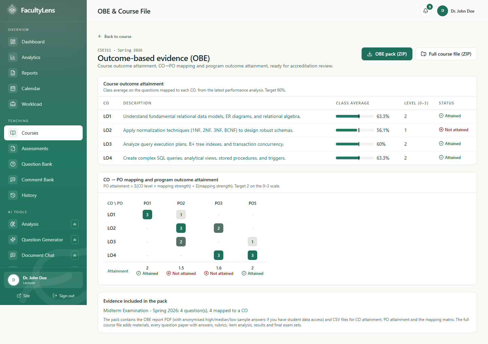<p align="center"><b>OBE & course outcome attainment</b></p></td>
</tr>
<tr>
<td>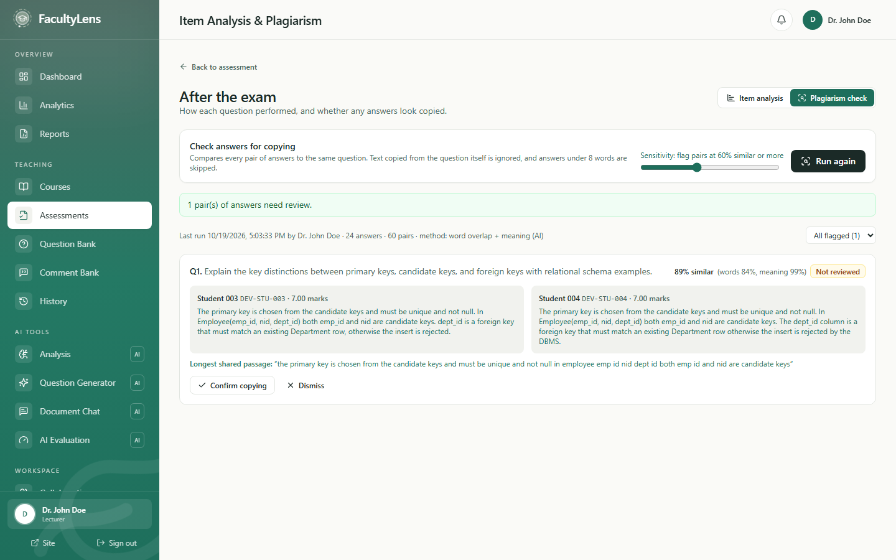<p align="center"><b>Copied-answer check</b></p></td>
<td><p align="center"><b>Constrained question generator</b></p></td>
</tr>
</table>

<details>
<summary><b>More screenshots</b> (exam builder, course design, analytics, workload, mobile grading …)</summary>
<br />

<table>
<tr>
<td width="50%">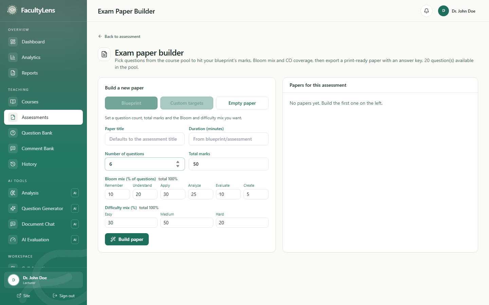<p align="center"><b>Exam paper builder</b></p></td>
<td width="50%">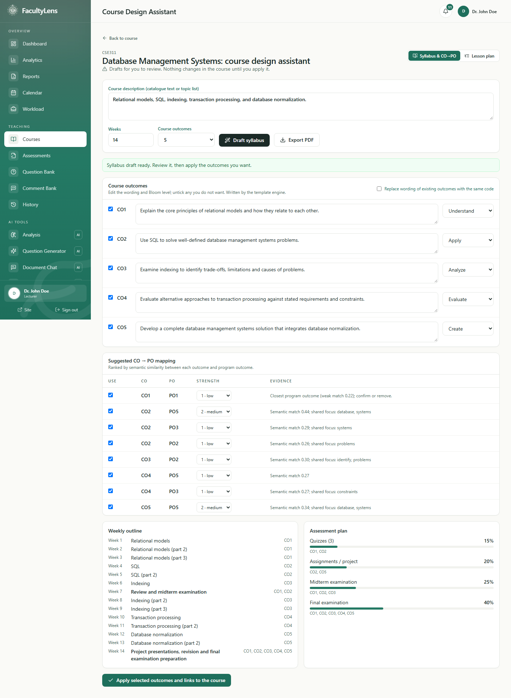<p align="center"><b>Course design assistant</b></p></td>
</tr>
<tr>
<td><p align="center"><b>Academic analytics</b></p></td>
<td><p align="center"><b>Assessment blueprint</b></p></td>
</tr>
<tr>
<td>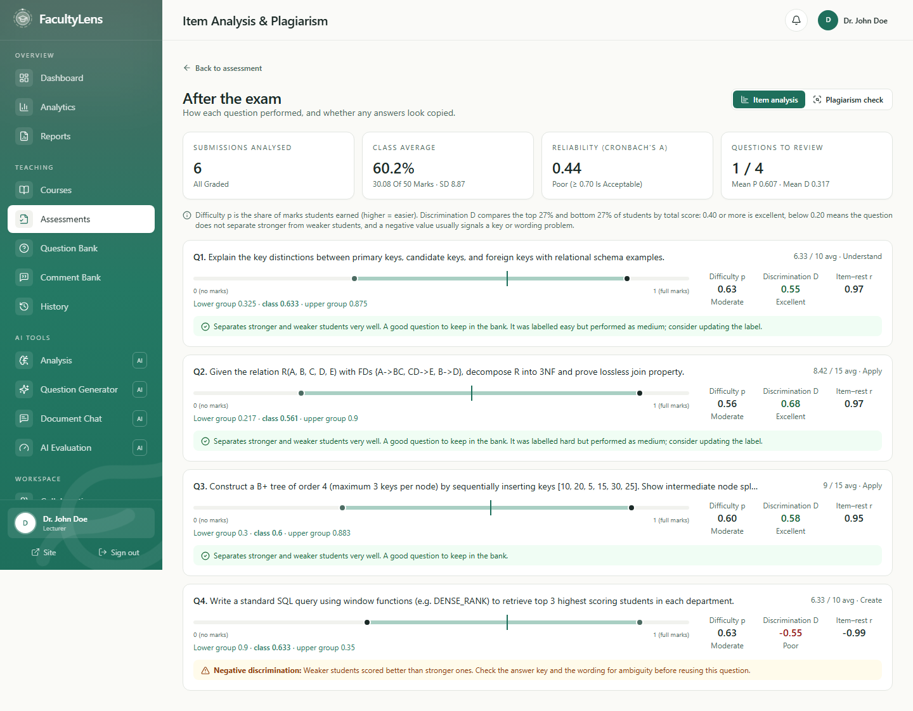<p align="center"><b>Item analysis</b></p></td>
<td>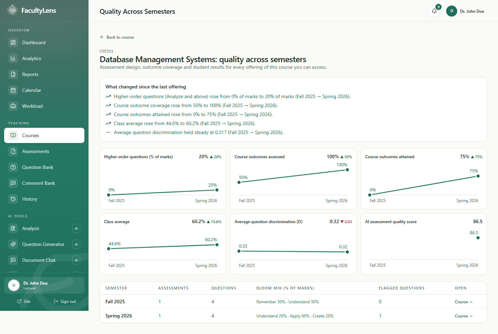<p align="center"><b>Quality across semesters</b></p></td>
</tr>
<tr>
<td>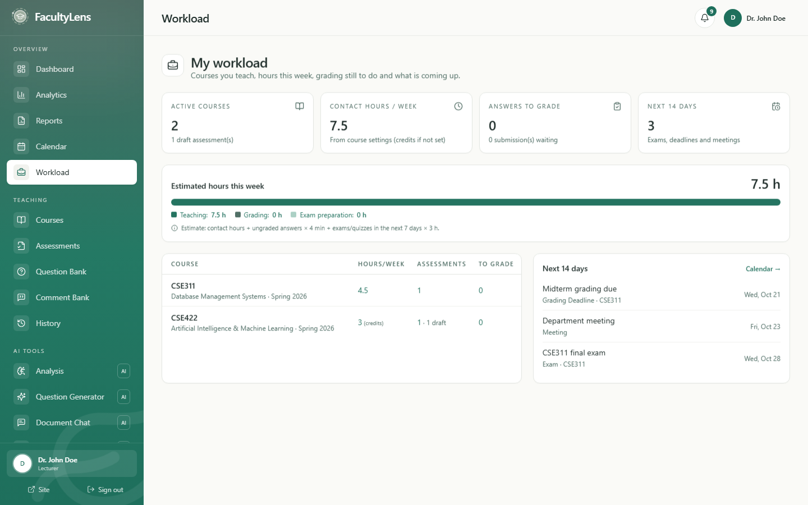<p align="center"><b>Workload</b></p></td>
<td>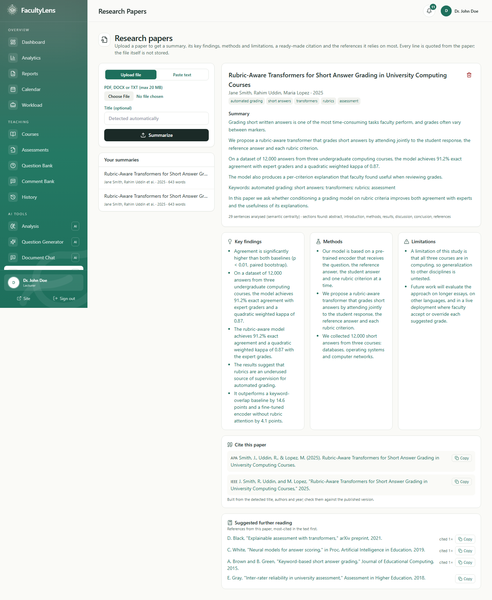<p align="center"><b>Research paper summary</b></p></td>
</tr>
<tr>
<td>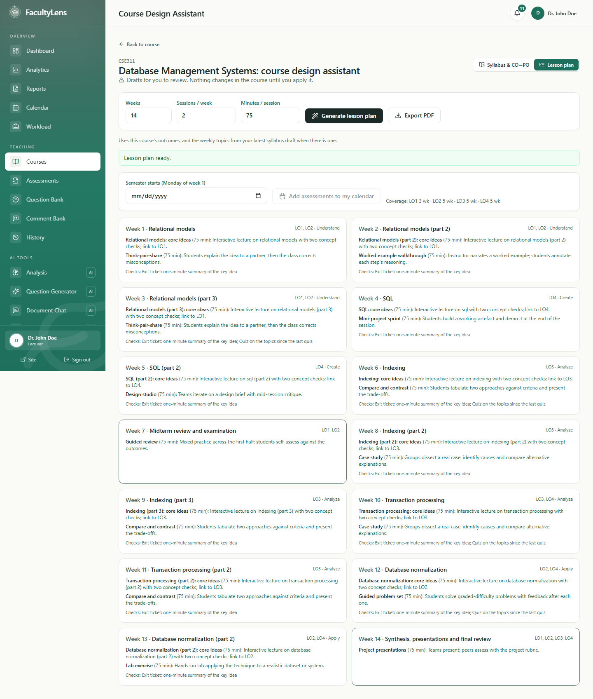<p align="center"><b>Lesson plan</b></p></td>
<td>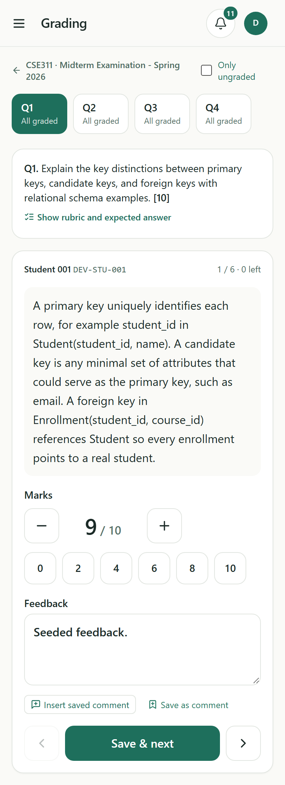<p align="center"><b>Mobile grading</b></p></td>
</tr>
</table>

</details>

<sub>Screenshots use synthetic demo data ("Dr. John Doe" and generated students).</sub>

---

## How it works

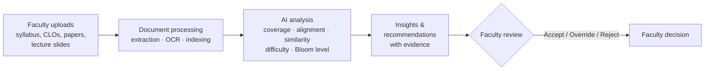

**Human in the loop.** AI produces findings and suggestions. Nothing changes a grade, question, mapping or approval until the faculty member acts on it.

### Example result

| Category | Score |
| --- | ---: |
| Topic coverage | 88% |
| Learning-outcome alignment | 84% |
| Question diversity | 79% |
| Difficulty balance | 76% |
| Repetition risk | 91% |
| Cognitive diversity | 74% |
| **Overall quality** | **82 / 100** |

> **Finding:** Question 6 is highly similar to a previous examination question, and Learning Outcome 4 has limited coverage.
> **Recommendation:** Replace Question 6 with a scenario-based question that assesses the analytical part of Learning Outcome 4.

---

## AI under the hood

<p align="center"></p>

The administrator chooses **local** (nothing leaves your server) or **hosted** (higher quality, through OpenRouter) in Platform settings. Every tool falls back to a local model if the hosted one fails, and records which model produced the result.

| Capability | Model | Notes |
| --- | --- | --- |
| Writing, chat answers, rubric drafts, proofreading | Claude Opus 5.5 → Gemini 3.8 Flash → DeepSeek V4.1 Flash → Claude Haiku 5.5 → local Qwen 2.5 | LangChain `with_fallbacks` |
| Checking generated answers against the documents | Claude Haiku 5.5 judge (hosted) · NLI DeBERTa + MiniLM (local) | Rejects swapped facts, wrong numbers and invented details |
| Handwriting and scanned-paper OCR | Gemini 3.8 Flash → Claude Haiku 5.5 → TrOCR | Draft text, always checked by faculty |
| Lecture transcription | Whisper large-v3-turbo via faster-whisper (8-bit) | ~2× real time on CPU; key terms + proofreading fix sound-alikes |
| Similarity, alignment, retrieval | MiniLM · bge-m3 (multilingual, for copied answers) | Scores always shown with their evidence |
| Translation · read-aloud | NLLB-200 · Kokoro (English) · Microsoft neural voice (বাংলা) | Local voice as automatic fallback |

Idle local models unload after 15 minutes so the service stays within its memory budget. Details: [docs/AI_TOOLKIT.md](docs/AI_TOOLKIT.md).

---

## Architecture

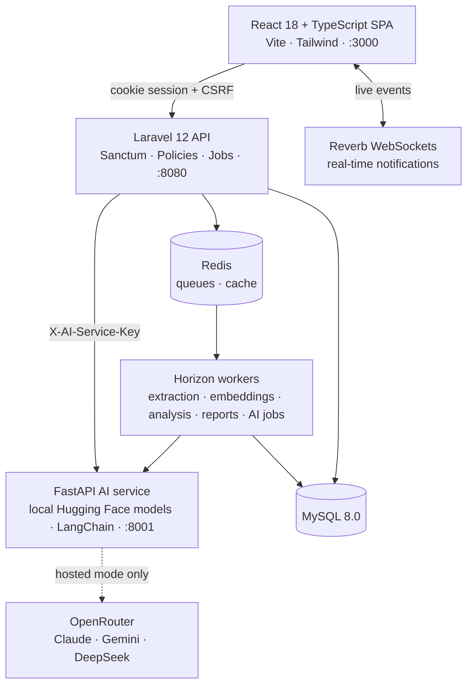

| Layer | Technology |
| --- | --- |
| **Frontend** | React 18, TypeScript 5, Vite 6, Tailwind CSS 3, React Router 6, Lucide icons, Laravel Echo + Pusher JS |
| **Backend** | Laravel 12 (PHP 8.2+), Sanctum cookie auth, Horizon, Reverb, MySQL 8.0, Redis 7 |
| **Documents** | Poppler `pdftotext` for PDFs (correct word spacing and math symbols), Smalot PDF Parser fallback, PHPWord for DOCX, OCR for scans |
| **AI service** | Python 3.11, FastAPI, Pydantic v2, LangChain, sentence-transformers, faster-whisper, Kokoro, edge-tts |
| **Testing** | PHPUnit, Vitest + Testing Library, Pytest, Ruff, Playwright + axe accessibility checks, GitHub Actions CI |
| **Infrastructure** | Docker Compose (dev) and a hardened production compose with nginx, php-fpm and a private AI service |

<details>
<summary><b>Project structure</b></summary>

```text
FacultyLens/
├── frontend/                 React SPA
│   ├── src/{components,pages,services,hooks,context,features,types}
│   └── tests/e2e/            Playwright journeys and faculty UAT walkthroughs
├── backend/                  Laravel API
│   ├── app/{Http/Controllers/Api,Models,Services,Jobs,Policies}
│   ├── routes/api.php
│   ├── database/migrations
│   └── tests/{Feature,Unit}  PHPUnit suite (in-memory SQLite) + e2e shell journeys
├── ai-service/               FastAPI + Hugging Face + LangChain
│   ├── app/{api,schemas,services}
│   ├── datasets/             evaluation and safety benchmarks
│   └── tests/
├── docs/                     design notes, validation and test reports
├── scripts/                  backup, restore, test and evaluation helpers
├── .github/workflows/ci.yml  continuous integration
├── docker-compose.yml        development stack
└── docker-compose.prod.yml   production stack
```

</details>

---

## Feature deep dives

<details>
<summary><b>AI chat with academic documents (RAG)</b></summary>

Faculty ask natural-language questions about their own syllabi, lecture notes and question papers, and get **document-grounded answers with source citations**.

```text
React chat UI ──► Laravel (auth + retrieval) ──► FastAPI (grounded answer) ──► Laravel (persist) ──► UI
                        │                                  │
                        │  1. authorize scope (owner only) │  5. prompt = SYSTEM + UNTRUSTED CONTEXT + QUESTION
                        │  2. embed question (MiniLM)      │  6. generate (hosted chain or local model) or extractive fallback
                        │  3. cosine top-K over indexed    │  7. validate: cites [S#], no leaked instructions,
                        │     chunks, threshold            │     every claim backed by a passage
                        │  4. send ONLY authorized chunks  │  8. grounded=true only when context was used
```

- **Indexing.** When text extraction finishes, `GenerateDocumentEmbeddingsJob` splits the document into overlapping word-based chunks (`CHAT_CHUNK_SIZE` / `CHAT_CHUNK_OVERLAP`), embeds them with MiniLM via `POST /api/v1/embeddings/batch`, and stores them in `document_chunks` as packed float32 BLOBs. MySQL 8.0 has no vector type, so cosine similarity runs in the application. A content hash prevents re-embedding unchanged documents. Indexing state: `NOT_INDEXED → INDEXING → INDEXED | FAILED` (`STALE` after reprocessing).
- **Two models, two jobs.** MiniLM only ranks chunks. Answer text comes from the generation provider (hosted chain or local model). If none is available, a deterministic **extractive engine** answers from the most relevant lines. It understands slide decks: bullet lists under a matching heading, wrapped formulas, and probability expressions written in different notations.
- **Every claim is checked.** Before an answer is shown, each sentence is checked against the passages: abbreviations the documents define are spelled out, a hosted judge (or local NLI + similarity) rejects swapped facts, wrong numbers and invented details, and an answer that fails is replaced by quotes from the documents.
- **Slide-friendly extraction.** PDFs are extracted with `pdftotext` and Symbol-font glyphs are mapped to real Unicode, so formulas such as `P(a ∧ ¬j ∧ m)` survive.
- **Grounding & safety.**
  - Retrieval is restricted to documents the user may access *before* similarity is computed. Scopes are `COURSE`, `DOCUMENT` and `ASSESSMENT`.
  - Document text is passed to the model as **untrusted data**, and instructions found inside documents are ignored.
  - If nothing clears `CHAT_MIN_RELEVANCE_SCORE`, the assistant replies *"I couldn't find enough information about that in the documents available to this chat."*
  - Sources list real metadata only (document name, page, section when known), never fabricated pages or file paths.
  - Every answer carries a disclaimer. `CHAT_RATE_LIMIT` (30/min) throttles messages, and sessions are audit-logged.
  - A failed AI call saves nothing, so the question can simply be retried.
- **Endpoints.** `GET|POST /api/academic-chat/sessions`, `GET|PATCH|DELETE /api/academic-chat/sessions/{id}`, `GET /api/academic-chat/sessions/{id}/export?format=markdown|json`, `POST /api/academic-chat/sessions/{id}/messages`. The UI is at `/academic-chat` and `/courses/:courseId/chat`.
- **Limitations.** Scanned PDFs without a text layer are not indexed for chat. Page numbers exist for PDFs only. Similarity thresholds are engineering defaults, not correctness guarantees. Always verify answers against the cited source.

</details>

<details>
<summary><b>Constrained question generator</b></summary>

Faculty generate **draft** questions under explicit academic constraints. They are never random and never auto-published.

```text
Constraints (course · CO · PO · topic · type · difficulty · Bloom · marks · count · document scope)
        ↓
Document retrieval → relevant passages        Existing questions (assessment, question bank, previous papers)
        ↓                                                ↓
Generation model (hosted chain or local model) — or a constraint-driven template engine when none is available
        ↓
Validation per draft: type/difficulty/Bloom · CO alignment (≥0.70 strong / ≥0.50 weak)
                      · similarity (≥0.85 potential duplicate / ≥0.70 highly similar) · topic · marks
        ↓
Faculty review: Edit (original preserved, versioned) · Approve · Reject · Regenerate (with feedback)
        ↓
[Add to Assessment] — only for APPROVED drafts, only on explicit confirmation
```

- **Modes.** Standalone drafts for a course, or drafts for a specific assessment. Existing questions are supplied as "do not reproduce" context, and requested marks are checked against the remaining allocation and *warned about*, never auto-adjusted.
- **Validation is advisory.** Requested and AI-estimated values are shown side by side (`PASSED`, `PASSED_WITH_WARNINGS`, `FAILED`). Warnings are never hidden.
- **Security.** Course, assessment, CO/PO and document ownership is verified server-side. Retrieved text is untrusted. `QUESTION_GENERATION_RATE_LIMIT` (10/min) throttles requests, and every step is audit-logged.
- **Boundaries.** The generator never grades, never modifies existing questions, marks or mappings, and never claims academic correctness.
- **Endpoints.** `GET|POST /api/question-generation`, `GET /api/question-generation/{id}[/questions]`, `POST /api/question-generation/{id}/regenerate`, `PUT /api/generated-questions/{id}`, `POST /api/generated-questions/{id}/{approve|reject|regenerate|add-to-assessment}`. The UI is at `/question-generator` and `/courses/:courseId/question-generator`.

</details>

<details>
<summary><b>AI Toolkit</b></summary>

One page (`/ai-toolkit`) of everyday tools. Each result is a draft for the faculty member to check.

| Tool | What it does |
| --- | --- |
| Translate | English ↔ বাংলা, keeping academic terms, numbers and formatting |
| Read aloud | Natural English (Kokoro) and Bangla (Microsoft neural voice) speech, with a local fallback |
| Handwriting OCR | Reads handwritten answer sheets (images or PDFs) and can attach the reviewed text to a student's answer for grading assistance |
| Lecture transcription | Timestamped transcript; key terms and a proofreading pass fix misheard words ("cue" → "queue") |
| Notes & quiz | Summary, key points and a grounded draft quiz from a lecture or transcript; chosen items can go to the question bank |
| Question checker · Simplify · Bloom rewriter | Flags unclear wording, rewrites for a level of reader or a target Bloom level |
| Paper review | Bloom balance by marks, outcome coverage, duplicates and wording problems for a whole paper |
| Feedback drafter · Compare answers | Rubric-based feedback drafts (never marks), and a copying check for answers not stored in FacultyLens |

Details, models and limits: [docs/AI_TOOLKIT.md](docs/AI_TOOLKIT.md).

</details>

<details>
<summary><b>Explainability & transparency</b></summary>

Every important AI result has a **"Why?"** panel with progressive disclosure:

1. **What** FacultyLens produced and **why**, as one evidence-based sentence (never hidden reasoning).
2. **Evidence**: the wording that fired a rule, the actual similarity score (`0.82 / 1.00`, never a probability), threshold bands, LO text, rubric criteria and retrieved passages.
3. **Method & model**: `RULE_BASED`, `EMBEDDING_BASED`, `HYBRID`, `GENERATIVE` or `HUMAN_CONFIRMED`, with engine, prompt and embedding versions.
4. **Confidence**, only when the method produces one. Otherwise it reads "Not available".
5. **Limitations** per component.
6. **Faculty decision**: Accept, Reject, Mark as reviewed or **Override** with a reason. The AI value is kept for reference and every decision is audited.

See [docs/AI_EXPLAINABILITY.md](docs/AI_EXPLAINABILITY.md).

</details>

<details>
<summary><b>Assessment blueprints</b></summary>

Open `/assessments/:assessmentId/blueprint` to plan sections (for example *Section A: MCQ 10 × 1 = 10*), difficulty, Bloom, CO, PO and topic targets, and cross-dimension plan rows (*CO2 · Analyze · Medium · Problem solving · 2 × 5*).

- Deterministic validation reports `VALID`, `VALID_WITH_WARNINGS` or `INVALID`, with CO × difficulty and CO × Bloom matrices.
- **Blueprint Completeness** is a planning indicator, not an assessment-quality score.
- Finalized blueprints are immutable (edits create a new version), feed the question generator, and are compared with the actual question set (`MATCH` / `CLOSE` / `MISMATCH`).
- The blueprint never publishes the assessment or changes questions automatically.

See [docs/assessment-blueprint.md](docs/assessment-blueprint.md).

</details>

<details>
<summary><b>Assessment versioning</b></summary>

Open `/assessments/:assessmentId/versions` to create **v1.0**, a snapshot of the current questions, blueprint and approved rubrics, and follow `DRAFT → IN_REVIEW → APPROVED → FINALIZED`.

- Version numbers (`v1.0`, `v1.1`, `v2.0`) are generated server-side and never reused.
- Finalized, approved and student-referenced versions are immutable. The action is always **Create new version** or **Restore as new version**.
- Comparison is deterministic and reports `MODIFIED` / `ADDED` / `REMOVED` / `UNCHANGED`, marks, CO/Bloom/difficulty changes and quality-metric differences.
- Analyses, reports, analytics and student submissions record the exact `assessment_version_id`.

See [docs/assessment-versioning.md](docs/assessment-versioning.md).

</details>

<details>
<summary><b>Faculty collaboration & notifications</b></summary>

- **Collaboration hub** (`/collaboration`, the sidebar's Collaboration link). In one place you can:
  - accept or decline invitations sent to you;
  - see each of your courses with its team size, pending invitations and open discussions;
  - invite a colleague to any of your courses;
  - open the courses shared with you, with their owner and your role;
  - revoke invitations you sent.
- **How it works end to end:**
  1. The owner invites a colleague by e-mail as Editor, Reviewer or Viewer.
  2. The colleague accepts from their hub or from the e-mailed link.
  3. The course appears in their Courses list marked "Shared · role", with only the actions that role allows.
  4. Discussions, @mentions and the activity feed keep everyone up to date.
  5. The owner can change a role or remove a member at any time, and access ends immediately.
- **Course-level membership.** The course creator is the single OWNER. Collaborators have the role **EDITOR**, **REVIEWER** or **VIEWER**, and nobody gains access to a course they weren't invited to.
- **Permission matrix** (`config/collaboration.php`) is enforced server-side through `CourseAccessService` and every policy. Student answers, grades and grading feedback are visible to Owner and Editor only.
- **Invitations** are single-use, expire, are stored as SHA-256 hashes, and arrive by e-mail and in-app notification.
- **Discussion threads** on courses, assessments, questions, reports, recommendations, rubrics and documents support replies, resolve/reopen and @mentions. Comments never change AI results or official content.
- **Version-aware editing.** Stale edits return `409` instead of overwriting a colleague's change.
- **Notifications.** Every important event creates an informational notification (`event → listener → queued job → notification bell`), delivered in real time over Reverb. Notifications never approve, finalize or grade anything. See [docs/NOTIFICATION_SYSTEM.md](docs/NOTIFICATION_SYSTEM.md).

</details>

<details>
<summary><b>Analytics, AI evaluation & institutional reports</b></summary>

- **Academic analytics** (`/analytics`) aggregates real records (analysis reports, finalized grades, performance runs, CO/PO runs, evaluation runs, audit log) for the courses you can access. Metrics without data show **N/A**, never fabricated zeroes. See [docs/academic-analytics.md](docs/academic-analytics.md).
- **AI evaluation** (`/ai-evaluation`) shows accuracy, macro/weighted F1, confusion matrices, similarity precision/recall, grading MAE/RMSE, RAG groundedness and refusal results, and regression gates. Every number comes from a persisted evaluation run. See [docs/ai-evaluation.md](docs/ai-evaluation.md) and [docs/AI_ACCURACY_EVALUATION_REPORT.md](docs/AI_ACCURACY_EVALUATION_REPORT.md).
- **Institutional reports** (`/reports`) follow `Preview → Validate access → Generate → Export → Download → Audit` in PDF, CSV or XLSX.
  - Scope is decided by the server from the course role matrix, never by the client.
  - Student reports are aggregates of finalized grades only. No names, identifiers or individual answers are exported.
  - Files live on private storage and expire after `REPORTS_EXPIRATION_DAYS` (default 7).
  - See [docs/institutional-reporting.md](docs/institutional-reporting.md).

</details>

<details>
<summary><b>Admin control center</b></summary>

A separate admin area for running the platform: users and roles, security and sessions, system health, queues, data quality, AI governance (provider choice, model chain, memory use, evaluations), backups, scheduled tasks, audit log, institution settings, e-mail, incidents, feature switches and environment checks. See [docs/ADMIN_PANEL.md](docs/ADMIN_PANEL.md).

</details>

---

## Getting started

### Prerequisites

- Docker Desktop with Docker Compose (give it at least 8 GB of memory)
- Node.js 20+ and npm, for the frontend dev server
- *(Optional, for running without Docker)* PHP 8.2+, Composer, Python 3.11+

### Quick start with Docker (recommended)

```bash
git clone https://github.com/Sakin542/FacultyLens.git
cd FacultyLens

cp backend/.env.example backend/.env          # dev values; DB_PASSWORD=root123 matches docker-compose.yml
docker compose up -d --build                   # API, MySQL, Redis, Horizon, Reverb, AI service, Mailpit, phpMyAdmin
docker compose exec app php artisan key:generate
docker compose exec app php artisan migrate --seed   # synthetic data: faculty@example.com / password123

cd frontend
cp .env.example .env
npm install
npm run dev                                    # http://localhost:3000
```

Check that everything is up:

```bash
curl http://127.0.0.1:8080/api/health          # {"status":"ok", ...}
curl http://127.0.0.1:8080/api/health/ready    # database, cache, storage, queue, ai_service all "ok"
```

> **Hosted AI (optional).** To use Claude, Gemini and DeepSeek, put `LLM_HOSTED_BASE_URL`, `LLM_HOSTED_API_KEY` and `LLM_HOSTED_MODEL` in a root `.env` file (git-ignored; see [`ai-service/.env.example`](ai-service/.env.example)), run `docker compose up -d ai-service`, then choose **Hosted** in Admin → Platform settings. Local models download on first use (several GB in total), so the first run of each tool is slow.

### Local services

| Service | URL |
| --- | --- |
| Web app | <http://localhost:3000> |
| Laravel API | <http://127.0.0.1:8080/api> |
| AI service | <http://127.0.0.1:8001/health> |
| Mailpit (dev e-mail inbox) | <http://localhost:8025> |
| phpMyAdmin | <http://localhost:8081> |
| MySQL | `127.0.0.1:3307` |
| Reverb WebSockets | `localhost:8085` |

<details>
<summary><b>Running without Docker</b></summary>

#### Backend

```bash
cd backend
cp .env.example .env
composer install && php artisan key:generate && php artisan migrate --seed
php artisan serve --host=127.0.0.1 --port=8080
php artisan queue:work --queue=emails,default   # second terminal (or `php artisan horizon` on Linux/macOS)
```

#### AI service

```bash
cd ai-service
python -m venv venv
venv\Scripts\activate            # Windows
source venv/bin/activate         # Linux / macOS
pip install -r requirements.txt
cp .env.example .env             # HF_MODEL_NAME, optional HF_TOKEN, AI_SERVICE_API_KEY (must match backend)
uvicorn app.main:app --host 0.0.0.0 --port 8001
```

The embedding model loads once at startup. `GET /health` is liveness, and `GET /ready` returns 503 until the model is ready.

#### Frontend

```bash
cd frontend
cp .env.example .env             # VITE_API_BASE_URL=http://127.0.0.1:8080/api
npm install
npm run dev
```

</details>

<details>
<summary><b>Environment variables</b></summary>

| File | Purpose |
| --- | --- |
| `backend/.env.example` / `.env.production.example` | Laravel: APP_KEY, DB, Redis, `AI_SERVICE_URL` + `AI_SERVICE_API_KEY`, CORS, Sanctum, session, reports |
| `frontend/.env.example` / `.env.production.example` | `VITE_*` values only. Everything here ships to the browser, so never put secrets in it |
| `ai-service/.env.example` / `.env.production.example` | FastAPI: models, hosted provider (`LLM_HOSTED_*`), toolkit engines, memory budget, chat and generation limits |
| `.env.prod.example` | Values for `docker-compose.prod.yml` (DB/Redis passwords, image tag, TLS directory) |

`.env` files are git-ignored. Only the `*.example` templates are committed.

</details>

---

## Testing

Every pull request to `main` runs [**GitHub Actions CI**](.github/workflows/ci.yml): the PHPUnit suite, the AI service's `ruff check` and pytest suite (Python 3.11, CPU PyTorch), and the frontend's Vitest suite plus the strict TypeScript production build. Merge only when all three jobs are green.

| Suite | Tests |
| --- | ---: |
| Backend (PHPUnit, in-memory SQLite) | 925 |
| AI service (pytest) | 647 |
| Frontend (Vitest) | 422 |

```bash
cd backend && php artisan test                 # PHPUnit feature + unit suite (in-memory SQLite only)
cd frontend && npm test && npm run build       # Vitest + strict TypeScript production build
cd ai-service && pytest -q && ruff check .     # FastAPI tests + lint
cd frontend && npm run test:e2e                # Playwright browser journeys + axe accessibility (Docker stack up)
bash backend/tests/e2e_all.sh                  # every end-to-end journey against the Docker stack (real AI)
scripts/test-all.sh [--e2e] [--golden]         # aggregated regression run (also scripts/test-all.ps1)
```

> **Run the PHPUnit suite from the host, not inside the Docker app container.** The suite refuses to start unless it is connected to the in-memory SQLite database, so it can never touch the development MySQL data. The Playwright journeys need the full Docker stack, so they run locally rather than in CI.

Validation results live in [docs/E2E_VALIDATION_REPORT.md](docs/E2E_VALIDATION_REPORT.md), [docs/FACULTY_UAT_REPORT.md](docs/FACULTY_UAT_REPORT.md) and [docs/PRODUCTION_READINESS.md](docs/PRODUCTION_READINESS.md).

---

## Security & privacy

- **Sessions.** Sanctum cookie sessions (HttpOnly, `Secure` in production, SameSite=lax), CSRF on every change, and explicit CORS origins.
- **Authorization** happens server-side only, using the course role matrix (`OWNER / EDITOR / REVIEWER / VIEWER`) plus `FACULTY / ADMIN` roles. Every resource id is re-checked.
- **Private storage** for documents and reports, streamed through authenticated endpoints only.
- **Security headers** (CSP, HSTS, nosniff, frame-ancestors, Referrer-Policy) and structured request logs without bodies or tokens.
- **Rate limits** on auth, uploads, AI analysis, chat, generation, collaboration, search and reports.
- **AI safety.** An internal service key, timeouts, safe error messages, and document text always treated as untrusted context. The hosted provider's API key never leaves the AI service.
- **Your choice of where data goes.** In local mode nothing leaves your server. In hosted mode, academic text (and OCR images) is sent to the provider; the Bangla read-aloud voice uses Microsoft's online service unless set to local.
- **Student privacy.** Reports and analytics are aggregates, and AI never assigns or changes grades, approvals or mappings.

---

## Production & operations

- **Production stack.** `docker-compose.prod.yml` runs **nginx** (TLS, static React, security headers) → **php-fpm** → MySQL, Redis, worker, scheduler, and a private **AI service** with no published ports.
- **Backup & restore.** `scripts/backup.sh` (MySQL dump + private storage + manifest) and `scripts/restore.sh` (verified restore into a scratch database first).
- **After an update.** Rebuild the AI image (`docker compose build ai-service`) when its dependencies change, and restart queue workers (`php artisan horizon:terminate`) after job code changes.
- **Guide.** Release flow, smoke tests, rollback and monitoring are in [docs/DEPLOYMENT.md](docs/DEPLOYMENT.md).

---

## Documentation

| Topic | Document |
| --- | --- |
| API reference | [docs/API.md](docs/API.md) |
| Deployment & troubleshooting | [docs/DEPLOYMENT.md](docs/DEPLOYMENT.md) |
| AI Toolkit & models | [docs/AI_TOOLKIT.md](docs/AI_TOOLKIT.md) |
| Admin control center | [docs/ADMIN_PANEL.md](docs/ADMIN_PANEL.md) |
| AI evaluation & accuracy | [docs/ai-evaluation.md](docs/ai-evaluation.md) · [docs/AI_ACCURACY_EVALUATION_REPORT.md](docs/AI_ACCURACY_EVALUATION_REPORT.md) |
| AI safety | [docs/AI_SAFETY_TESTING.md](docs/AI_SAFETY_TESTING.md) · [docs/AI_HALLUCINATION_POLICY.md](docs/AI_HALLUCINATION_POLICY.md) · [docs/AI_PROMPT_INJECTION_DEFENSE.md](docs/AI_PROMPT_INJECTION_DEFENSE.md) |
| Explainability | [docs/AI_EXPLAINABILITY.md](docs/AI_EXPLAINABILITY.md) |
| Analytics & reporting | [docs/academic-analytics.md](docs/academic-analytics.md) · [docs/institutional-reporting.md](docs/institutional-reporting.md) |
| Blueprints & versioning | [docs/assessment-blueprint.md](docs/assessment-blueprint.md) · [docs/assessment-versioning.md](docs/assessment-versioning.md) |
| Notifications & e-mail | [docs/NOTIFICATION_SYSTEM.md](docs/NOTIFICATION_SYSTEM.md) · [docs/REALTIME_NOTIFICATION_SYSTEM.md](docs/REALTIME_NOTIFICATION_SYSTEM.md) · [docs/EMAIL_SYSTEM.md](docs/EMAIL_SYSTEM.md) |
| Testing & quality | [docs/FACULTY_UAT_REPORT.md](docs/FACULTY_UAT_REPORT.md) · [docs/REGRESSION_TEST_MATRIX.md](docs/REGRESSION_TEST_MATRIX.md) · [docs/DATA_QUALITY_INTEGRITY_REPORT.md](docs/DATA_QUALITY_INTEGRITY_REPORT.md) |

---

## Roadmap

- [x] Assessment quality analysis, LO alignment, similarity, difficulty and Bloom analysis
- [x] Document chat (RAG) with citations, claim checking, rename and export
- [x] Constrained question generator, rubrics and AI grading assistance
- [x] Blueprints, exam builder, versioning, collaboration, analytics and institutional reports
- [x] Real-time notifications and e-mail
- [x] AI-assisted syllabus design, CO → PO mapping and lesson plans
- [x] Research-paper summarization
- [x] Faculty workload, calendar and course quality tracking across semesters
- [x] AI Toolkit, multi-model hosted AI with local fallback, admin control center, CI
- [ ] Playwright browser journeys in CI
- [ ] Monitoring and alerts when the AI service, workers or the hosted provider fail
- [ ] One-command download of all local models
- [ ] GPU support for faster transcription

---

## Contributing

```bash
git checkout -b feature/your-feature-name
git add <files>
git commit -m "Add your feature"
git push origin feature/your-feature-name
```

Before opening a pull request:

- [ ] Backend, frontend and AI tests pass (CI runs them on the PR)
- [ ] No TypeScript, PHP or Python errors (`npm run build`, `php artisan test`, `ruff check .`)
- [ ] Environment variables documented in the matching `.env.example`
- [ ] Docker services start cleanly
- [ ] Security and academic safety reviewed: AI suggests, faculty decides

---

## Author

FacultyLens is a personal project built and maintained by [Sakin542](https://github.com/Sakin542).

| | |
| --- | --- |
| **Project** | FacultyLens |
| **Domain** | AI for Academic Life |
| **Institution** | Ahsanullah University of Science and Technology (AUST) |
| **Repository** | [github.com/Sakin542/FacultyLens](https://github.com/Sakin542/FacultyLens) |

## License

Released under the [MIT License](LICENSE).

---

<div align="center">


**FacultyLens** · *See academic work through a smarter lens.*

AI assists · Faculty decides

</div>
